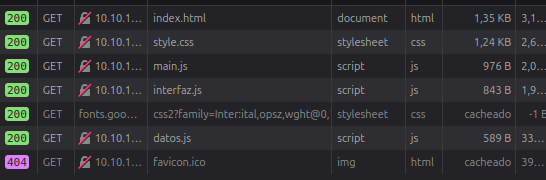

# Página Informativa: Visual Studio vs Visual Studio Code

Aplicación web interactiva desarrollada con **HTML5**, **CSS3** y **JavaScript modular (ES6 Modules)** para comparar las características de *Visual Studio* y *Visual Studio Code*. La interfaz permite filtrar la información en tiempo real mediante botones de navegación y una barra de búsqueda dinámica.

---

## 🛠️ Funcionalidades Añadidas

* **Navegación Interactiva por Botones:** Permite conmutar la visibilidad de cada herramienta (*VSCode*, *VS* o *Ambos*) modificando dinámicamente las clases del DOM.
* **Búsqueda Dinámica en Tiempo Real:** Filtrado en directo mediante el evento `input` que evalúa las coincidencias de texto introducidas por el usuario.
* **Reconocimiento de Términos y Abreviaturas:** Detección de búsquedas específicas para palabras clave como `"code"`, `"vs"`, `"visual studio"` y frases compuestas.
* **Gestión de Estados de la Interfaz:**
  * Muestra el estado actual en pantalla mediante un indicador informativo (`#infoMostrados`).
  * Muestra una vista de error personalizada (`#mensajeError`) cuando la búsqueda no devuelve coincidencias.
* **Generación Dinámica de Listas:** Inserción de las características de cada software en el DOM a partir de arrays importados desde un módulo de datos.
* **Arquitectura Modular (ES Modules):** Separación clara de responsabilidades en archivos independientes (`datos.js`, `interfaz.js` y `main.js`).

---

## 🌐 Captura de la pagina red



--

## 🚀 Instrucciones de Ejecución

Entrar en el servidor de clase, entrar el boton de pagina informativa y ahi se encuentran todas las funcionalidades.

## 📁 Estructura del Proyecto

```text
.
├── index.html          # Estructura principal de la aplicación
├── css/
│   └── style.css       # Estilos visuales y manejo de clases (.mostrar, .esconder)
├── js/
│   ├── datos.js        # Módulo de datos (arrays con las características de cada software)
│   ├── interfaz.js     # Módulo DOM (referencias a elementos y funciones de visibilidad)
│   └── main.js         # Módulo principal (eventos, lógica de búsqueda y renderizado)
└── images/             # Logotipos e imágenes del sitio web